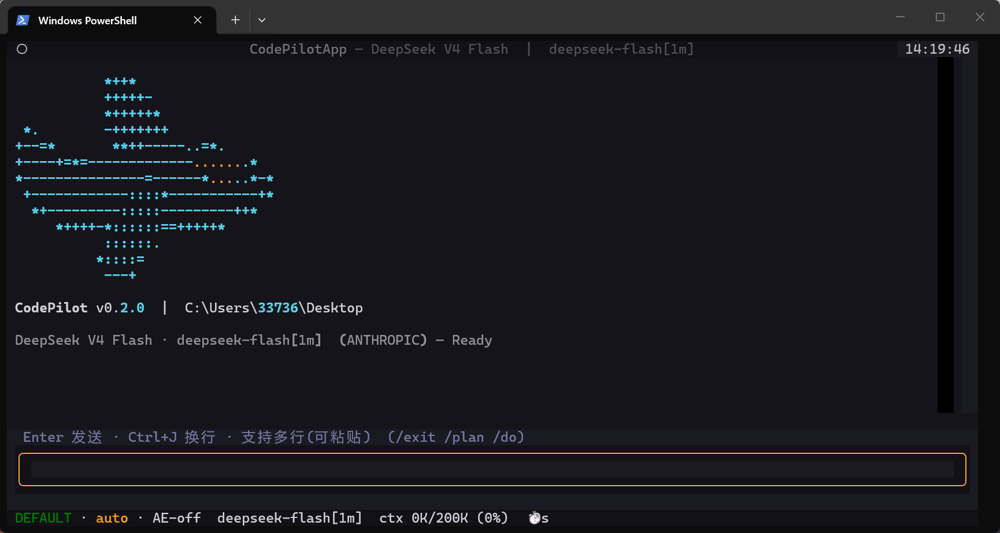

<p align="center"></p>

<h1 align="center">CodePilot</h1>

<p align="center">
  <strong>A multi-agent AI coding assistant in your terminal</strong><br>
  The model reads/writes files, runs commands, and searches code through tools to autonomously complete multi-step coding tasks.
</p>

<p align="center">
  <a href="https://github.com/LaL1ame/CodingTool/actions/workflows/test.yml"></a>
  
  
  <a href="LICENSE"></a>
</p>

<p align="center"><a href="README.md">简体中文</a> ｜ English</p>

---

CodePilot is an agentic coding tool that lives in your terminal and works on your Git repository as the workspace: you describe a task, and it plans, reads/writes files, searches code, and runs commands on its own — rendering the whole process live in a TUI. Both the protocol layer and the agent framework are self-built (no LangChain or similar frameworks).

```text
$ codepilot

  > Extract login's password validation into its own function and add tests

  ● read   codepilot/auth/login.py
  ● edit   codepilot/auth/login.py
  ● write  tests/test_login.py
  ● run    pytest tests/test_login.py

  Done: extracted validate_password() and added tests.

  ctx 12K/200K (6%)   [DEFAULT]   /plan · /do
```

---

## What it is

For an AI assistant to actually *do* work instead of just *talking*, it must cross several thresholds. Each layer of CodePilot answers one of them:

| Problem | CodePilot's answer |
| --- | --- |
| The model only talks, doesn't act | Six built-in tools (read / write / edit / glob / grep / run) that operate the real system |
| Long tasks spin out of control | ReAct loop + structured stop conditions + result-aware stall detection + resumable checkpoints |
| Permissions & trust | Five-layer defense: blacklist, path sandbox, rule engine, mode fallback, human-in-the-loop approval |
| Context window overflow | Two-layer compression (large-result offload + LLM structured summary) + token budget circuit breaker |
| Forgetting across sessions | JSONL session persistence & restore + long-term memory (instruction injection + auto note distillation) |
| Repeated prompting | Skill packs + Hook lifecycle hooks + MCP external tool integration |
| Parallel-task conflicts | SubAgent delegation + Git Worktree isolation + Team multi-agent collaboration |

---

## Core capabilities

### Agent loop & reliability
- ReAct loop: call model → execute tools → feed back results → repeat, until done.
- Six structured stop reasons: `done / limit / stall / unknown_tool / cancelled / error`; hitting the round cap or a stall is a *resumable* pause (`/continue`).
- Result-aware stall detection: a `tool name + args + raw result` fingerprint distinguishes legitimate polling from a true dead loop.
- Side-effect tools serialize as fences; read-only tools run concurrently — safe and fast.

### Multi-model access (self-built protocol layer)
- Handwritten Anthropic / OpenAI dual-protocol streaming adapters: SSE line parsing, `tool_use`/`tool_result` pairing, three-segment usage accumulation, prompt cache breakpoints.
- A unified `Delta` incremental event model — the UI consumes events without knowing the loop's internals.

### Multi-agent collaboration
- **SubAgent delegation**: a unified `agent` tool hands subtasks to independent sub-agents (clean context / restricted tools / own permissions), in role-defined or Fork-inherited modes.
- **Git Worktree isolation**: each isolated task gets its own directory + branch with managed lifecycle (24h TTL cleanup, fail-closed — never falls back to the main workspace), so parallel file edits never collide.
- **Team collaboration**: the main agent acts as a Lead that creates long-lived teams and spawns members working in parallel — three isolated tool surfaces, a shared task board (dependency-gated atomic claiming), a JSONL mailbox with file locks, an approval loop, cross-process context restore, git-merge consolidation (conflicts auto-rollback + report), and a focused coordinator mode.

### Context / session / memory
- Two-layer context compression: oversized tool results offloaded to disk + LLM structured summary; a "anchor + increment" token estimator with no tokenizer dependency.
- JSONL session persistence with protocol-aware restore (`-c` / `--resume` seamless continuation, 30-day expiry auto-cleanup).
- Long-term memory: `.rules` instruction injection + background auto-distillation of four note categories after each round.

### Extensibility
- **Skills**: three-level discovery (project > user > builtin), two-phase injection, dynamic tool whitelist narrowing, `/reload` hot-reload.
- **Hooks**: 8 events / 4 actions (command / http / prompt / subagent), with a `tool_pre` interception channel.
- **MCP**: self-built JSON-RPC client over stdio (Content-Length framing) and Streamable HTTP (JSON / SSE), connecting in the background as "ready-when-ready".

### TUI
An async terminal UI built on [Textual](https://github.com/Textualize/textual): chat area, live context-usage status bar, subtask observation panel (F3), release-mode cycling (F2), permission approval modal, and multi-line input (Enter to send / Ctrl+J for newline).

---

## Quick start

### 1. Requirements
- Python 3.10+ (CI runs on 3.11)
- A model API key (Anthropic Claude or an OpenAI-compatible endpoint)

### 2. Clone & install
```bash
git clone https://github.com/LaL1ame/CodingTool.git
cd CodingTool
pip install -e .
```

### 3. Configure your own API key

CodePilot needs a model API key to run. **The repo contains no secrets** — `config.yaml` is `.gitignore`d, so your key stays local and is never committed.

① Copy the config template:

```bash
cp config.example.yaml config.yaml
```

② Edit `config.yaml` and replace `api_key` with your own (Anthropic Claude):

```yaml
providers:
  - name: "Claude Sonnet"
    protocol: anthropic                # Anthropic official protocol
    model: claude-sonnet-4-6
    base_url: https://api.anthropic.com
    api_key: sk-ant-your-key-here      # ← replace with your key
```

③ Or use an OpenAI-compatible endpoint (e.g. a relay / DeepSeek):

```yaml
providers:
  - name: "OpenAI-compatible"
    protocol: openai
    model: gpt-4o
    base_url: https://api.openai.com   # or your relay address
    api_key: sk-your-key-here
```

> 💡 With multiple providers configured, you'll be asked to pick one on startup.

### 4. Run
```bash
codepilot          # start from any Git repo root
codepilot -c       # continue the most recent session
codepilot --resume # pick a past session to restore
codepilot --new    # force a fresh session
```

---

## Usage

### Common slash commands
| Command | What it does |
| --- | --- |
| `/help` | Command help |
| `/plan` `/do` | Read-only planning / resume execution (tool-axis switch) |
| `/memory` `/forget` | View / delete long-term memory |
| `/compact` | Manually compact context |
| `/continue` | Resume from a paused checkpoint |
| `/agents` `/bg <id>` | Subtask list / move to background manually |
| `/worktree list` `/worktree rm <name>` | Manage isolated worktrees |
| `/team` | Team system (create / spawn / tasks / merge, etc.) |

### Key bindings
| Key | Action |
| --- | --- |
| `Enter` | Send |
| `Ctrl+J` | Newline |
| `Esc` | Cancel the current round |
| `F2` | Cycle release mode (manual → auto → strict) |
| `F3` | Subtask observation panel |
| `Ctrl+B` | Move a foreground delegation to background |

---

## Architecture at a glance

The `codepilot/` package is assembled by the entry point `main.py`, with layered one-way dependencies:

```
codepilot/
├── main.py          # assembly entry: load config, wire subsystems, start the TUI
├── agent.py         # agent loop: ReAct orchestration + stop policy + stall detection
├── providers.py     # provider abstraction: Anthropic / OpenAI dual protocols
├── protocols.py     # protocol layer: streaming Delta, ToolCall, usage
├── chat.py          # conversation manager
├── modes.py         # mode state machine: PLAN/BUILD × manual/auto/strict
├── tools/           # tool system: Tool base + six built-ins + registry
├── permissions/     # permissions: blacklist, sandbox, rule engine, human-in-the-loop
├── context/         # context: token estimation, budget, offload, compaction
├── session/         # session: JSONL store, restore orchestration, expiry cleanup
├── memory/          # long-term memory: instruction injection, auto notes
├── skills/          # skills: 3-level loading, whitelist, dual modes
├── hooks/           # hooks: event-condition-action model
├── mcp/             # MCP client: stdio/HTTP transports, tool discovery
├── subagents/       # sub-agents: role definitions, delegation, transcript replay
├── worktree/        # Git worktree isolation: lifecycle management
├── teams/           # team system: Lead orchestration, task board, mailbox, approval, merge
├── commands/        # slash commands: registry, parser, dispatcher, completion
├── prompt/          # prompt building: stable prefix + volatile tail blocks
└── ui/              # Textual TUI: app, widgets, theme
```

Execution path: a user message enters the ReAct loop in `Agent.run()`; each round rebuilds the layered system prompt, streams the model, executes tools on demand (read-only concurrent / side-effect serial), feeds results back, and repeats until done or a stop policy fires — all driven by an event stream into the TUI.

---

## Tests & CI

- **943 automated tests** (pytest): `python -m pytest -q`
- GitHub Actions runs the full suite on `main` push / PR (see `.github/workflows/test.yml`).
- Each feature stage ships with both automated tests and real-machine acceptance records (headless end-to-end + TUI scenarios).

---

## Development approach

This project follows a **design-first** process: every feature starts with four design documents (`spec → plan → task → checklist`) and is coded only after approval.

- Stage docs: `docs/stateNN-<topic>/{spec,plan,task,checklist}.md` (state4 ~ state20)
- Key architectural decisions: `docs/decisions.md` (ADR-001 ~ 005)
- Cross-stage progress: `SHARED_PROGRESS.md`

Code style is enforced by `ruff`; commit messages follow Chinese Conventional Commits.

---

## Known boundaries

- Member agents are in-process coroutines (not real process isolation); no cross-machine / cross-network collaboration.
- MCP's real npx/node server spawn compatibility on Windows is not yet resolved (a known limitation, not a protocol defect).
- A local single-user CLI tool: no server, no multi-user sharing.

---

## Dependencies

Minimal — only 3 runtime dependencies:

- [`textual`](https://github.com/Textualize/textual) — TUI framework
- [`httpx`](https://github.com/encode/httpx) — HTTP client (streaming model API requests)
- [`pyyaml`](https://github.com/yaml/pyyaml) — config parsing

Dev dependencies: `pytest`, `pytest-asyncio`.

---

## License

Open-sourced under the [MIT License](LICENSE).
